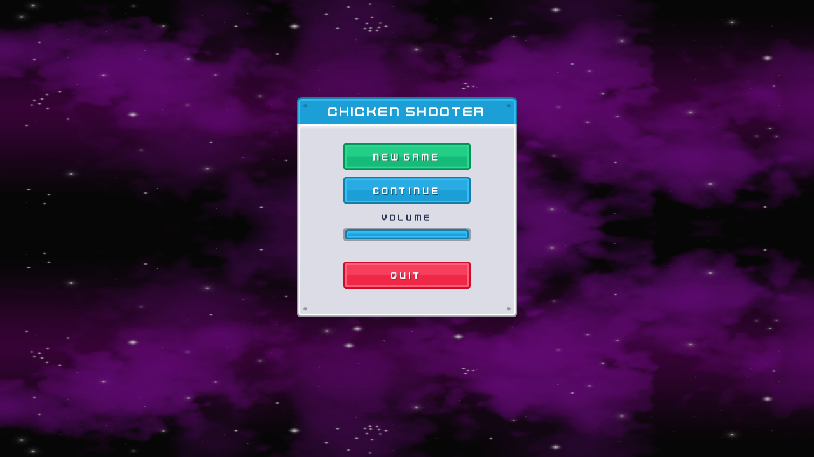
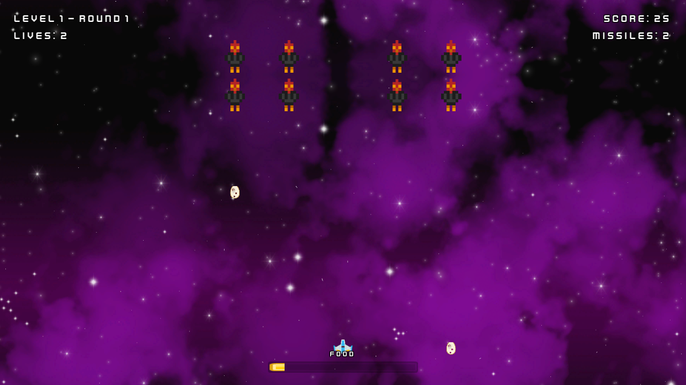
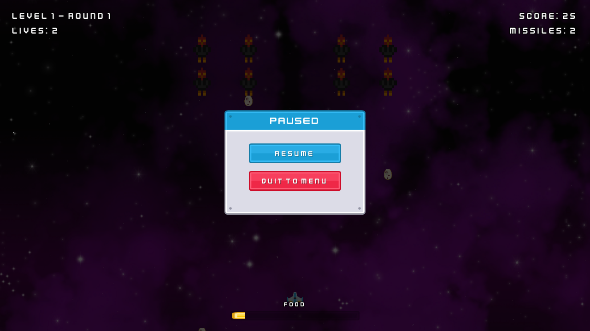
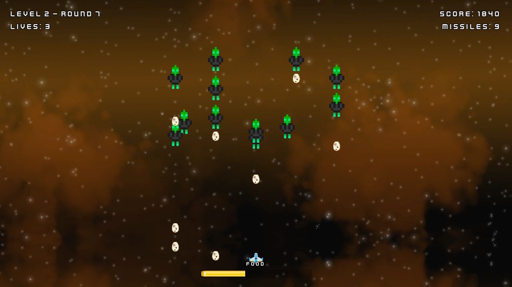
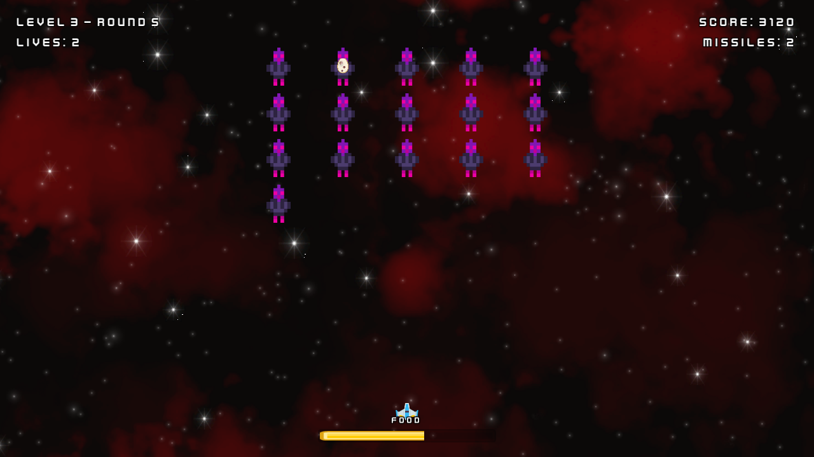
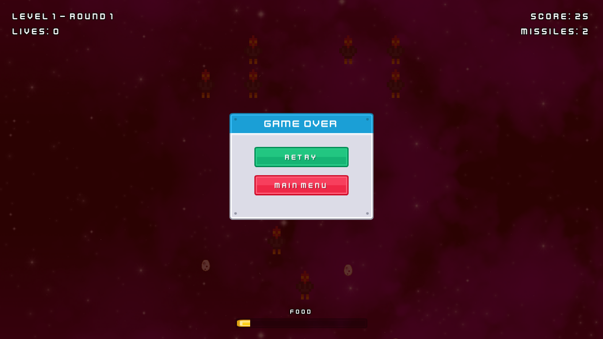
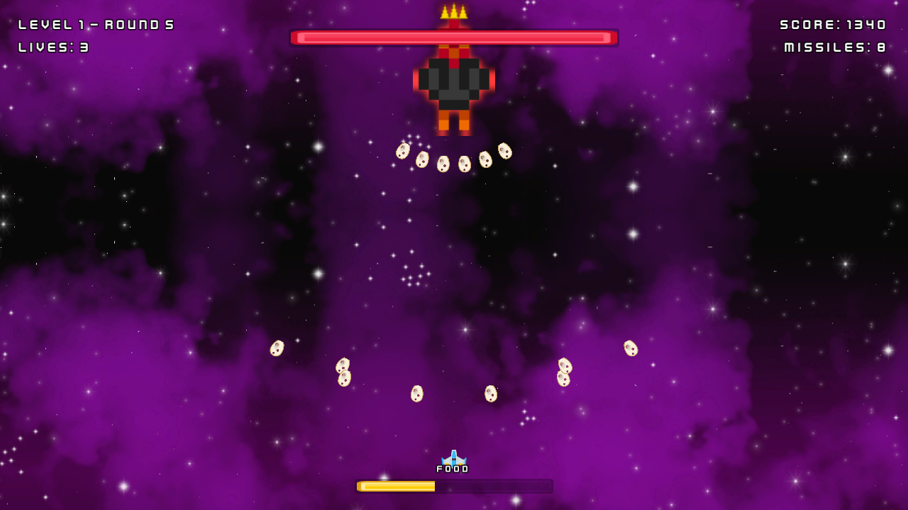
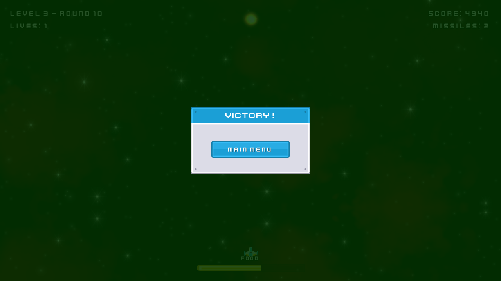

# GD-HW3

This is a chicken invaders style top down shooter i made in unity for the computer game design course. you fly a little ship at the bottom of the screen and shoot waves of space chickens that drop eggs on you, and unlike the last two homeworks this one is not endless, it has 3 levels in 3 separate scenes with 5, 7 and 10 rounds, a boss at the end of each one, and your progress gets saved to a json file so you can quit and continue later.





## Controls

WASD or the arrow keys move the ship in all four directions and it can't leave the screen. Space shoots, you can just hold it. X fires a missile that wipes every chicken, egg and asteroid on screen, you start with 2 of them. Esc pauses.



## Features

Each level looks and plays different. Level 1 is black hens in a plain grid over a purple nebula, level 2 is green armored ones in a V shape that take two hits and drop eggs faster, level 3 is violet alien ones packed tight that dive at you a lot more. A couple of rounds in every level are asteroid rounds instead of chickens, the rocks just fall and you shoot them or dodge.





Chickens fly in from the top and sit in formation, drop eggs at random times, and every now and then one leaves the line and dives straight at where you are, then loops back to its spot if it misses. Dead chickens sometimes drop food or a gift box. Gift boxes level up your gun, level 1 is a single laser, level 2 is two side by side, level 3 is a three way spread, and getting hit knocks it back down one level. Food fills the bar at the bottom and when it's full you get an extra missile.

You got 3 lives and you blink for a moment after a hit so you don't lose two at once. Lose them all and it's game over, retry puts you back at round 1 of the same level with 3 fresh lives.



Every level ends with a boss that has its own health bar at the top. It rains eggs in a fan, dives down at you and goes back up, and when it's under 30 percent health it gets angry, shoots twice as fast and calls in small chickens to help. Missiles only take a chunk off the boss instead of killing it. Beat the third boss and you get the victory screen and the save gets wiped so the next run starts clean.





There's also screen shake on explosions, a white flash on enemies when they get hit, bloom on the lasers, a scrolling nebula background that changes per level, separate music for the menu, each level and the victory screen, and sounds for shooting, eggs, explosions and pickups.

## How it's built

There are 4 scenes, MainMenu, Level1, Level2 and Level3, all added in build settings. Moving to the next level is done with SceneManager.LoadScene using the scene name stored in that level's data, not a build index. GameManager is a singleton with DontDestroyOnLoad so score, lives, missiles, gun level and the food bar all carry over when the scene changes. AudioManager and PoolManager stay alive the same way.

Saving is a plain json file called savegame.json in Application.persistentDataPath. It holds level index, round index, score, lives, missile count, gun level and food progress. It saves by itself every time a round ends, and on game over it gets rewritten to round 1 of the current level. Continue on the main menu only lights up if that file exists, and it loads the numbers into GameManager first and then loads the right scene.

```json
{
    "levelIndex": 2,
    "roundIndex": 3,
    "score": 1240,
    "lives": 3,
    "secondaryMissiles": 1,
    "weaponPowerLevel": 2,
    "foodProgress": 0.4
}
```

Levels are all data. LevelDataSO has the level number, scene name, music, the list of rounds, the boss prefab and the next scene name. WaveDataSO describes one round, which formation it is (grid, V or asteroid field), how many enemies, speed, and how often they dive. WeaponDataSO has the bullet prefab, damage, speed, fire rate and spread angles for each gun level. Making level 2 and 3 was mostly just making new assets with harder numbers and plugging in a different enemy and boss prefab, the Enemy, Boss and EnemySpawner scripts are the same for all three.

Bullets, eggs, food, gift boxes and explosions all come from an object pool instead of Instantiate and Destroy. ObjectPool keeps a stack of inactive copies per prefab and PoolManager just has Spawn and Despawn on top of that. One thing that bit me, since the pooled objects live under the PoolManager that never gets destroyed, eggs that were still on screen came along into the next scene, so now it puts everything back in the pool whenever a scene loads.

The boss is a small state machine, an enum with Entry, ClusterEggs, DiveStrike and Enraged and a switch in Update that runs the right one. The health bar doesn't know about the boss directly, the boss fires a c# event with its current and max health and the bar just listens. Same idea for the HUD, it listens to GameManager events for score, lives, missiles, round and food instead of reading them every frame.

All input goes through the new Input System with an input actions asset, nothing uses the old Input class.

## Credits

All the art and sound is free CC0 stuff, mostly from kenney.nl and opengameart.org. The full list is in [CREDITS.md](CREDITS.md).
